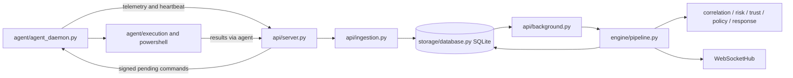
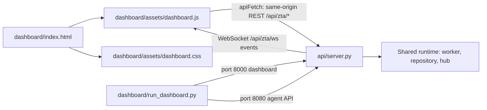
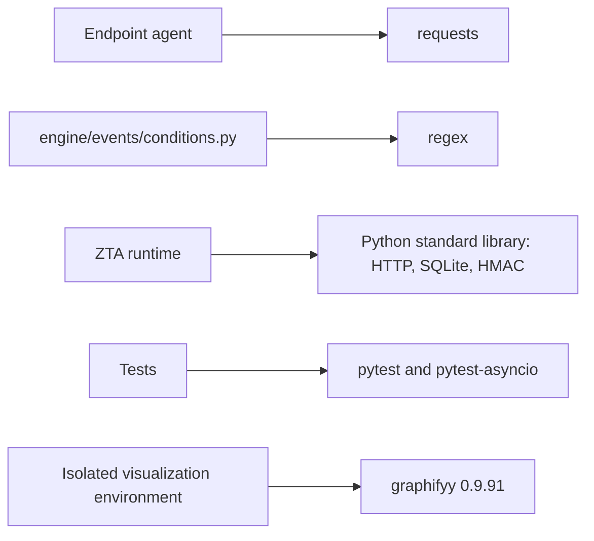

# Code and flow visualization

Use [Graphify-Labs/graphify](https://github.com/Graphify-Labs/graphify), whose
official Python distribution is **graphifyy** (double y). This is a development
tool, separate from the ZTA runtime. No graph database, JavaScript package, MCP
server, assistant hooks, or optional Graphify extras are required.

## Generate interactive graphs

From the repository root, create a separate environment (Python 3.11+):

```sh
python -m venv .venv-graphify
# Linux/macOS:
.venv-graphify/bin/python -m pip install graphifyy==0.9.91
.venv-graphify/bin/python scripts/graphify.py
```

On Windows, use `.venv-graphify/Scripts/python.exe` for both commands.
Open `graphify-out/graph.html` for searchable nodes and dependencies, and
`graphify-out/callflow.html` for the architecture/call-flow export. The generated
`graph.json` and `GRAPH_REPORT.md` provide machine-readable edges and a report.
Regenerate after source changes. Generated files stay local and are ignored.
The script resolves the repository root even when launched from another folder.

`--code-only` uses local AST extraction without an LLM or API key. Tests remain
in the graph so their links to runtime code can be explored. Graphify distinguishes
extracted and inferred edges; neither proves a runtime request occurred. In
particular, dynamic HTTP routes and WebSocket messages may not resolve into
cross-language edges. The source-backed diagrams below supply that context.
The HTML exporters may load visualization assets from a CDN when opened.

## Architecture



## Authentication and command authorization

```mermaid
sequenceDiagram
    participant UI as dashboard.js
    participant API as api/server.py
    participant Auth as api/auth.py
    participant DB as SQLite
    participant Agent as Endpoint agent
    UI->>API: POST /api/zta/auth/login (username, password)
    API->>Auth: login
    Auth->>DB: Verify password hash; store session token hash
    Auth-->>UI: Access token and identity via API
    UI->>API: REST Authorization Bearer token
    API->>Auth: identity and permission checks
    UI->>API: WebSocket subprotocol zta-token.TOKEN
    API->>Auth: Check stream permission and revalidate session
    Agent->>API: Agent ID and provisioned bearer credential
    API->>API: _authenticate_agent checks ZTA_AGENT_TOKENS
    API-->>Agent: HMAC-signed command with identity and expiry
    Agent->>Agent: authorization.verify before allowed execution
```

Sources: `api/auth.py`, `api/server.py`, `dashboard/assets/dashboard.js`,
`agent/commands/authorization.py`, and `agent/commands/command_receiver.py`.
Operator sessions expire after eight hours; the configured `ZTA_ADMIN_TOKEN`
also supports legacy administrator access. Operator identity, agent bearer
credentials, and command HMAC signatures are distinct checks.

## Frontend and backend connections



## Dependencies



See `pyproject.toml` for declared runtime/test dependencies. Graphify's base
package includes its own parsing and graph libraries; the separate environment
keeps those out of ZTA deployments. This overview is maintained documentation;
use the generated graph for detailed symbol/import relationships.
